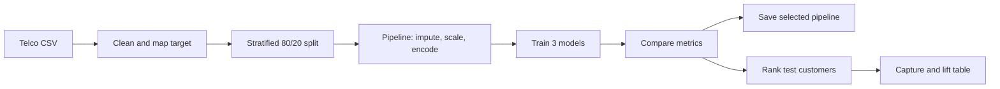

# Customer Churn Prediction

A churn classifier on the IBM Telco dataset that compares three scikit-learn models, keeps all preprocessing inside pipelines to avoid leakage, and ranks test customers by churn probability so a retention team can see who to review first.


## Why This Exists

I wanted a project that shows the part of machine learning that matters in a business setting: not just a high score, but a ranked list a team can act on. Retention teams usually have a fixed review budget, so the useful question is "which customers should we look at first?" rather than "what is the accuracy?"

This project answers that question on a public dataset, with honest limits about what the numbers do and do not prove.

## What It Does

- Cleans the Telco CSV, maps `Churn` to 1/0, and drops the customer ID.
- Builds a scikit-learn `Pipeline` with median imputation, standard scaling, and one-hot encoding, fitted on training rows only.
- Trains Logistic Regression, Decision Tree, and Random Forest on a stratified 80/20 split.
- Compares the models with accuracy, precision, recall, F1, and ROC-AUC.
- Ranks test customers by predicted churn probability and reports capture and lift at 10%, 20%, and 30% review budgets.
- Saves the selected pipeline and every report and figure under `models/` and `reports/`.



## Data

| Property | Value |
|----------|-------|
| Source | IBM Telco Customer Churn (committed at `data/telco_churn.csv`) |
| Customers | 7,043 |
| Input features | 19 |
| Target | `Churn` (Yes/No → 1/0) |
| Churn rate | 26.54% (1,869 churned) |
| Blank `TotalCharges` | 11, all zero-tenure customers |
| Duplicate rows | 0 |
| Training / test rows | 5,634 / 1,409 |
| Test churners | 374 |
| Features after encoding and scaling | 45 |

## Stack

| Layer | Technology | Why |
|-------|------------|-----|
| Language | Python 3.11+ | Standard for tabular ML |
| Dataframes | pandas, numpy | Loading, cleaning, segment checks |
| Modeling | scikit-learn | Pipelines keep preprocessing leakage-free |
| Artifact | joblib | Saves the fitted pipeline, not just the estimator |
| Plots | matplotlib (Agg) | Reproducible figures in CI and headless runs |
| Notebook | Jupyter | Exploratory analysis kept separate from training code |
| Testing | pytest + pytest-cov | 12 offline tests at 79% coverage |
| Lint | Ruff | Fast, replaces flake8 + isort |

## Project Tree

```text
customer-churn-prediction/
├── data/
│   └── telco_churn.csv              # Public IBM Telco dataset
├── notebooks/
│   └── 01_eda.ipynb                 # Exploratory analysis
├── src/
│   ├── data_preparation.py          # Cleaning and preprocessing pipeline
│   ├── train.py                     # Model definitions and training
│   ├── evaluate.py                  # Metrics, confusion matrix, ROC, importance
│   └── retention_analysis.py        # Test-set ranking, capture, and gains
├── tests/
│   ├── test_pipeline.py             # 9 offline tests for clean/train/evaluate
│   └── test_retention_analysis.py   # 3 tests for capture and lift
├── models/
│   └── churn_model.joblib           # Saved selected pipeline (8 KB)
├── reports/
│   ├── model_comparison.csv
│   ├── classification_report.txt
│   ├── feature_importance.csv
│   ├── retention_priority.csv
│   └── figures/                     # ROC, confusion matrix, gains, importance
├── main.py                          # Entry point
├── requirements.txt
├── pyproject.toml                   # Ruff and pytest configuration
├── .pre-commit-config.yaml
├── LICENSE
└── README.md
```

## Run

Verified on Linux with Python 3.14.8. The commands below were re-run in a fresh virtual environment.

```bash
git clone https://github.com/abosameh522/customer-churn-prediction.git
cd customer-churn-prediction
python -m venv .venv
source .venv/bin/activate          # Windows: .venv\Scripts\activate
python -m pip install -r requirements.txt
python main.py
```

`main.py` loads the CSV, trains all three models, prints the comparison, and rewrites `models/churn_model.joblib` plus every file in `reports/`.

To run the tests and lint:

```bash
python -m pytest -q
ruff check .
```

To open the exploratory notebook:

```bash
jupyter notebook notebooks/01_eda.ipynb
```

The saved pipeline can score new rows without repeating the preprocessing:

```python
import joblib
import pandas as pd

pipeline = joblib.load("models/churn_model.joblib")
customers = pd.read_csv("data/telco_churn.csv")
customers["TotalCharges"] = pd.to_numeric(customers["TotalCharges"], errors="coerce")
customers["Churn"] = customers["Churn"].map({"Yes": 1, "No": 0})
features = customers.drop(columns=["customerID", "Churn"])
probabilities = pipeline.predict_proba(features)[:, 1]
```

## Results

### Model comparison

Test split: 1,409 customers, 374 churners, 0.5 threshold. Source: `reports/model_comparison.csv`.

| Model | Accuracy | Precision | Recall | F1 | ROC-AUC |
|-------|---------:|----------:|-------:|----:|--------:|
| Logistic Regression | 0.8055 | 0.6572 | 0.5588 | 0.6040 | 0.8419 |
| Random Forest | 0.8027 | 0.6633 | 0.5214 | 0.5838 | 0.8410 |
| Decision Tree | 0.7984 | 0.6347 | 0.5668 | 0.5989 | 0.8303 |

Logistic Regression leads on ROC-AUC, but the gap to Random Forest is 0.0009 on this split. I do not treat that as proof that one model is generally better. Recall is 55.88%, so about 44% of churners are missed at 0.5.

### Retention ranking

The selected pipeline ranks the same 1,409 test customers by predicted probability. Source: `reports/retention_priority.csv`.

| Review budget | Customers reviewed | Churners captured | Capture rate | Precision | Lift vs random |
|---------------|-------------------:|------------------:|-------------:|----------:|---------------:|
| Top 10% | 141 | 105 | 28.07% | 74.47% | 2.81× |
| Top 20% | 282 | 186 | 49.73% | 65.96% | 2.48× |
| Top 30% | 423 | 243 | 64.97% | 57.45% | 2.16× |

At a 20% review budget the ranked group holds 186 of 374 churners, versus about 20% expected under random selection. That is ranking lift, not a measured retention rate.

### Segment churn rates

Computed from `data/telco_churn.csv`.

| Segment | Churn rate |
|---------|-----------:|
| Month-to-month contract | 42.71% |
| Two-year contract | 2.83% |
| Tenure 0–12 months | 47.44% |
| Tenure 49–72 months | 9.51% |
| Electronic check payment | 45.29% |

### Random Forest feature importance

Source: `reports/feature_importance.csv`. These importances describe the Random Forest, not the selected Logistic Regression.

| Feature | Importance |
|---------|-----------:|
| tenure | 0.1416 |
| TotalCharges | 0.1275 |
| Contract_Month-to-month | 0.0905 |
| MonthlyCharges | 0.0894 |


## Learned

- **Pipelines are a leakage guard, not a convenience.** Fitting imputation and encoding inside `Pipeline` per model keeps the test split honest.
- **Accuracy hides the problem** at a 26.54% churn rate; recall, F1, and ROC-AUC tell a more useful story.
- **Ranking beats a single threshold** when the team has a fixed review budget: capture and lift make the trade-off explicit.
- **Ties and cutoffs need rules.** Equal scores keep input order, and cutoffs use the nearest whole row, so the table is reproducible.
- **Selection on one split is fragile.** A 0.0009 AUC gap is not a stable winner.

## Limitations

- One train/test split, no cross-validation, so metric differences are split-specific.
- The threshold stays at 0.5; no tuning or calibration is applied.
- The EDA uses the full dataset, including test rows, so it is descriptive, not held-out validation.
- Feature importance comes from Random Forest, not the selected model.
- `models/churn_model.joblib` is committed and tied to the dependency versions in `requirements.txt`.
- No intervention data, so the project does not estimate retained customers or revenue.

## Roadmap

- [ ] k-fold cross-validation for stable model selection.
- [ ] Threshold tuning on a separate validation set.
- [ ] Probability calibration and precision/recall curves.
- [ ] Compare gradient-boosting models (XGBoost, LightGBM, CatBoost).
- [ ] Batch scoring script and a small inference API.
- [ ] Move the model artifact out of git and rebuild it in CI (separate PR).
- [ ] Record runtime and inference latency (TODO: fill after a timed run).

## License

MIT — see [LICENSE](LICENSE). The Telco dataset keeps its original IBM terms; check them before redistributing.

## Contact

Ahmed Sameh — Data Engineer & Analyst  
GitHub: [@abosameh522](https://github.com/abosameh522)  
Open to Junior Data Engineer / Analytics Engineer roles (remote, Egypt-based).  
Availability: now (part-time) / full-time after graduation 2027.  
No visa sponsorship needed for remote roles.
